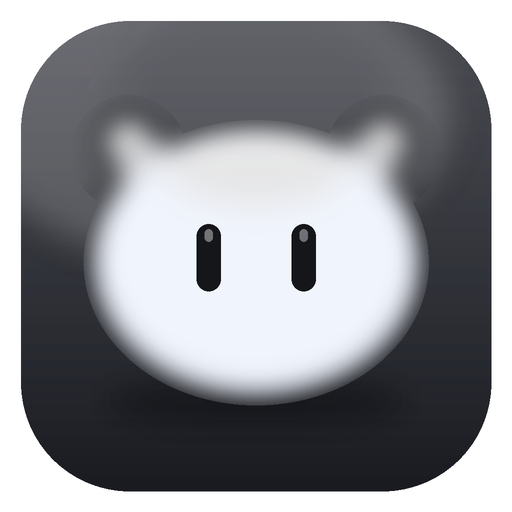
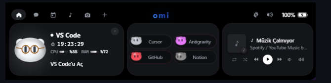
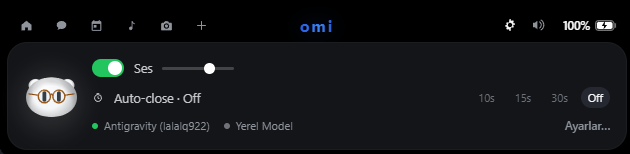
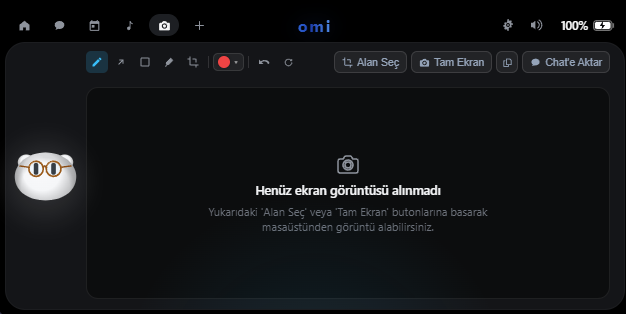
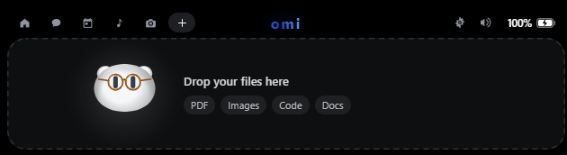
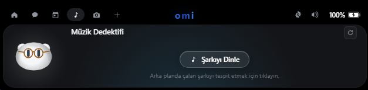
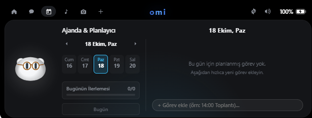
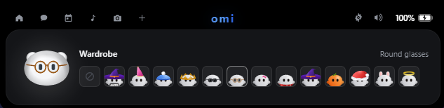
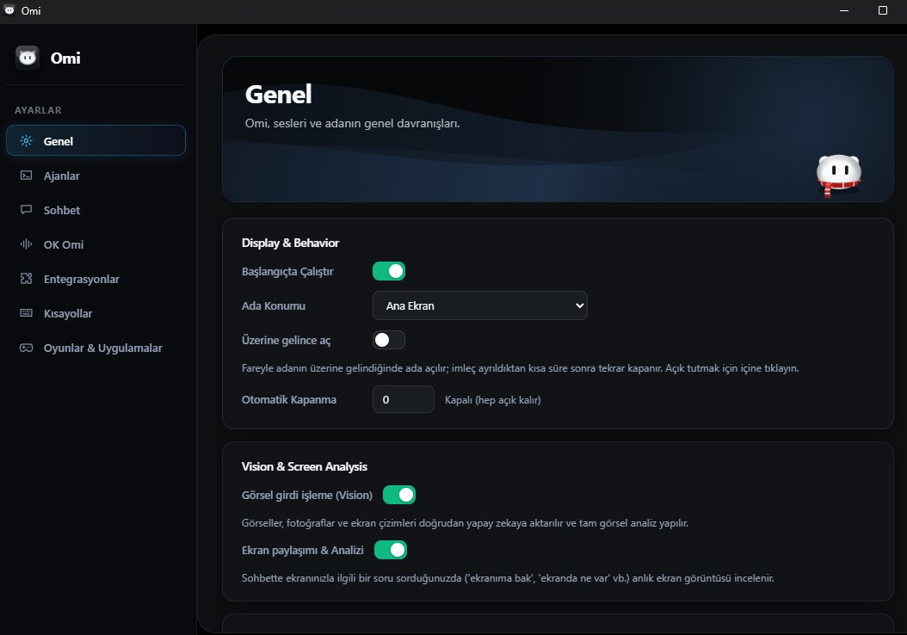

<div align="center">



# Omi

**Next-Generation AI Desktop Companion, Autonomous Coding Island & Voice Assistant**

*A sleek floating workspace island powered by Tauri 2, Rust & TypeScript. Combines real-time Google Antigravity voice conversations, autonomous vision-driven computer-use loops, modular glassmorphism control hub, and multi-provider agent orchestration.*

[](LICENSE)
[](https://github.com/omerfys/Omi)
[](https://tauri.app)
[](https://www.rust-lang.org)
[](https://www.typescriptlang.org)
[](https://vitejs.dev)

<br><br>



</div>

---

## Overview

**Omi** is a privacy-first, zero-idle-CPU desktop companion engineered with **Tauri 2 (Rust)** and **TypeScript**. Floating seamlessly at the top of your screen, Omi unifies code agents, conversational voice AI, computer-use automation, and system media controls into a cohesive dynamic island and modern glassmorphic dashboard.

Whether you're developing with Claude Code, Google Antigravity, or local LLMs, Omi gives you instant visual status, autonomous execution loops, one-click approvals, and hands-free voice interaction without disrupting your flow.

---

## Visual Showcase

A comprehensive visual overview of Omi's floating dynamic island, productivity cards, and management dashboard:

| Feature / Modül | Preview / Görsel | Açıklama / Description |
|:---|:---:|:---|
| **Dynamic Island (Compact)** |  | **Kompakt Tepe Adası:** Ekranda sıfır yer kaplayan, dinamik bildirimler ve agent aktivitelerinde yumuşakça genişleyen floating ada. |
| **Hızlı Kontroller & Model Durumu** |  | **Quick Controls & Engine Status:** Ses seviyesi, otomatik kapanma zamanlayıcısı, Google Antigravity ve yerel model aktiflik takibi. |
| **Sistem Monitörü & Medya Hub** |  | **Multi-Widget & Live Integrations:** VS Code CPU/RAM monitörü, Cursor / GitHub / Notion / Antigravity köprüsü ve WinRT medya oynatıcı. |
| **Ekran İşaretleme & Görsel Stüdyo** |  | **Screen Markup & Screenshot Studio:** Alan seçimi veya tam ekran yakalama, çizim/ok/kalem araçlarıyla işaretleme ve tek tıkla Chat'e aktarım. |
| **Sürükle-Bırak Dosya Paylaşımı** |  | **Drag & Drop Knowledge Hub:** PDF, görsel, kaynak kod ve dokümanları doğrudan adaya bırakarak anında context aktarımı. |
| **Müzik Dedektifi (Music Detective)** |  | **Music Detective & SMTC:** Arka planda veya ortamda çalan şarkıları tek dokunuşla tespit etme ve WinRT SMTC senkronizasyonu. |
| **Ajanda & Görev Planlayıcı** |  | **Agenda & Task Planner:** Hızlı görev ekleme, takvim görünümü ve günlük hedef tamamlanma ilerleme çubuğu. |
| **Omi Maskot Gardırobu (Wardrobe)** |  | **Companion Customization:** Omi maskotu için gözlükler, şapkalar, tematik kostümler ve mevsimsel kişiselleştirmeler. |
| **Modern Glassmorphism Hub** |  | **Settings & Hardware Preferences:** Yarı saydam cam paneller, ekran analizi, GPU hızlandırma ve tam Türkçe/İngilizce dil desteği. |

---

## Key Capabilities

### 1. Floating Island Quick Controls & Settings (Hızlı Ada Ayarları)
Floating seamlessly at the top of your primary display, Omi's quick controls give you immediate access to essential assistant preferences and model connectivity:

<div align="center">
  
</div>

- **Master Ses & Feedback Volume:** Anlık ses slider'ı ve tek tıkla sessize alma (mute) anahtarı ile asistan ses seviyesi kontrolü.
- **Auto-Close Timer (Otomatik Kapanma):** Adanın açık kalma süresini ihtiyacınıza göre yapılandırın (`10s`, `15s`, `30s` veya daima görünür kalması için `Off`).
- **Canlı Model & Hesap Durumu:** Bağlı aktif Google Antigravity hesabı ve yerel offline modelin çalışma durumu hakkında gerçek zamanlı göstergeler.
- **Doğrudan Ayarlar Erişimi:** Detaylı sistem, ekran analizi ve kısayol konfigürasyonları için tek tıkla ana kontrol paneline geçiş.

### 2. Conversational Voice Assistant & Wake Word
- **"Hey Omi" Voice Activation:** Hands-free background wake word spotter with zero CPU waste.
- **Continuous & Single-Turn Modes:** Switch between fluid bidirectional conversation or fast single-command triggers with configurable silence timeout.
- **Google Antigravity & Gemini Core:** Direct wire integration with Google Antigravity models and real-time OAuth token auto-refresh recovery.
- **Live Search Grounding:** Real-time Google Search integration for up-to-the-minute web facts, documentation, and live streaming queries.
- **Multilingual Neural TTS & STT:** High-performance local Turkish & English speech recognition combined with Piper Neural TTS (auto-terminated on idle to free RAM/CPU).

### 3. Screen Markup & Autonomous Computer Use
Seamlessly annotate visual bugs and guide autonomous AI agents with precision cursor coordinates.

<div align="center">
  
</div>

- **Screenshot & Annotation Studio:** Capture regions or full monitors, draw arrows, rectangles, freehand marks, and export directly into active agent conversations.
- **Vision-Driven Execution Loop:** Multi-step autonomous task execution (up to 100 continuous steps) powered by automated screenshot feedback and cursor coordinate planning.
- **Native Windows Control (`/computer`, `/cu`):** Precise mouse clicking, smooth drag movement, keystrokes, and multi-monitor window management.
- **Playwright Headless/Headed Navigation (`/playwright`, `/pw`):** End-to-end browser automation, DOM scraping, form automation, and session persistence.

### 4. Modular Glassmorphism Hub & Modern Settings
A unified frosted glass dashboard for complete control over behaviors, displays, audio, and AI pipelines.

<div align="center">
  
</div>

- **Translucent Glass Cards:** High-aesthetic dashboard built with frosted glass styling, dynamic border illumination, and fluid animated segmented controls.
- **Aurora Hero Wave:** Real-time canvas aurora wave animation with section-reactive Omi mascot state displays.
- **Vision & Screen Analysis Preferences:** Configure display selection, frame capture frequency, OCR enhancements, and GPU acceleration.
- **Full Turkish & English Localization:** Complete i18n support across all cards, dialogs, preferences, and assistant responses.

### 5. Media Detective & Universal WinRT Controls

<div align="center">
  
</div>

- **Music Detective:** Instantly detect and identify music playing in the background or environment with a single click.
- **Sub-Millisecond SMTC Tracking:** Real-time track metadata and album art from Spotify, Soundfy, YouTube Music, and browsers via native Windows WinRT APIs.
- **Zero-Process Overhead:** Native asynchronous Rust event channels eliminate heavy PowerShell polling.

### 6. Productivity, File Dropper & Companion Wardrobe

<div align="center">
  
  <br>
  
  <br>
  
</div>

- **Drag-and-Drop Knowledge Drop:** Instantly ingest PDFs, source code files, and images into Omi's active reasoning context.
- **Integrated Agenda & Daily Planner:** Maintain personal agendas, track daily checklist items, and watch completion percentages grow.
- **Wardrobe & Customization:** Personalize your desktop buddy with glasses, wizard hats, crowns, Santa caps, bunny ears, and seasonal outfits.
- **Deep Game & App Standby Mode:** Auto-detects active full-screen games and anti-cheat processes (Valorant/Vanguard, CS2, Minecraft, Steam), gracefully auto-hiding to guarantee zero latency and zero interference.

---

## Architecture

```
┌────────────────────────────────────────────────────────┐
│                      Omi Desktop                       │
├──────────────────────────┬─────────────────────────────┤
│   Dynamic Floating Top   │   Modular Glassmorphism     │
│   Island (Vite / TS)     │   Hub & Settings Dashboard  │
├──────────────────────────┴─────────────────────────────┤
│                    Tauri 2 IPC Bridge                  │
├────────────────────────────────────────────────────────┤
│                    Rust Core Engine                    │
│ ┌──────────────────────┐      ┌──────────────────────┐ │
│ │  Antigravity Voice   │      │  Autonomous Computer │ │
│ │  & Token Rotator     │      │  Use & Playwright    │ │
│ ├──────────────────────┤      ├──────────────────────┤ │
│ │  WinRT SMTC & Media  │      │  Game Mode Detector  │ │
│ │  Transport Pipeline  │      │  & Process Toolhelp  │ │
│ └──────────────────────┘      └──────────────────────┘ │
└────────────────────────────────────────────────────────┘
```

---

## Getting Started

### Prerequisites
- **OS:** Windows 10/11 (64-bit) or modern Linux distribution
- **Rust:** 1.80+ (`rustup default stable`)
- **Node.js:** 18+ & npm

### Quick Start

1. **Clone the repository:**
   ```bash
   git clone https://github.com/omerfys/Omi.git
   cd Omi
   ```

2. **One-Click Launch (Windows):**
   ```cmd
   start-omi.bat
   ```
   *Automatically sets up environment, clears stale processes, and starts Omi.*

3. **Manual Development:**
   ```bash
   cd windows
   npm install
   npm run tauri dev
   ```

4. **Production Build:**
   ```bash
   cd windows
   npm run build
   ```

---

## Privacy & Security

- **Local-First Processing:** Voice wake word spotting and STT run locally on your hardware.
- **Secure Token Storage:** API keys and OAuth tokens are stored in the OS Credential Manager (never plain text).
- **Zero Telemetry:** Omi does not collect, track, or phone home any personal usage data.

---

## License

Distributed under the [MIT License](LICENSE). Open-source for developers, creators, and tinkerers.
