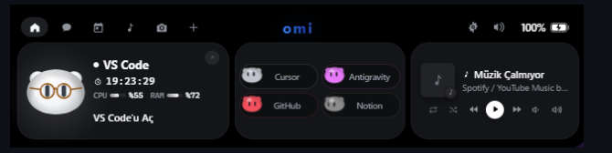
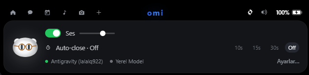
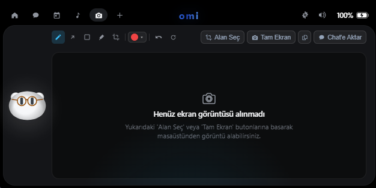
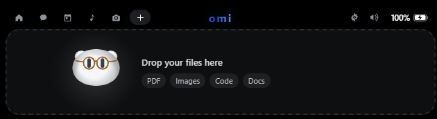
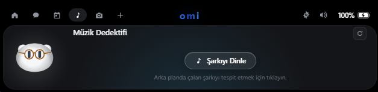
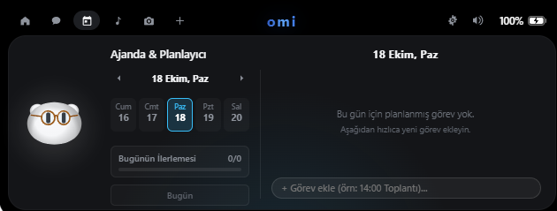
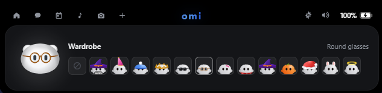
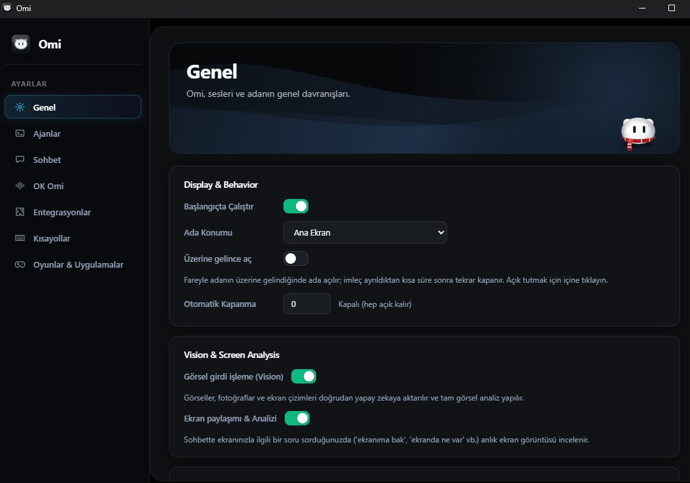

<div align="center">


# Omi

**Yeni Nesil Yapay Zeka Masaüstü Asistanı, Otonom Kodlama Adası & Sesli Yardımcı**

*Tauri 2, Rust ve TypeScript ile güçlendirilmiş zarif bir yüzen ada. Gerçek zamanlı Google Antigravity sesli sohbeti, otonom görsel güdümlü bilgisayar kullanım döngüleri, modüler glassmorphism kontrol paneli ve çoklu model orkestrasyonu bir arada.*

<p align="center">
  <b>🇹🇷 Türkçe</b> • <a href="README.md">🇺🇸 English</a>
</p>

[](LICENSE)
[](https://github.com/omerfys/Omi)
[](https://tauri.app)
[](https://www.rust-lang.org)
[](https://www.typescriptlang.org)
[](https://vitejs.dev)

<br><br>



</div>

---

## Genel Bakış (Overview)

**Omi**, gizlilik odaklı, boştayken %0 CPU tüketen ve **Tauri 2 (Rust)** ile **TypeScript** mimarisi üzerinde inşa edilmiş modern bir masaüstü asistanıdır. Ekranınızın üst kısmında zarif bir şekilde konumlanan Omi; kodlama agent'larını, sesli yapay zekayı, otonom bilgisayar kullanım otomasyonlarını ve sistem medya denetimlerini akıcı bir dinamik ada ile modern yarı saydam (glassmorphism) kontrol merkezinde bir araya getirir.

İster Claude Code veya Google Antigravity ile kod geliştirin, ister yerel çevrimdışı modeller çalıştırın; Omi çalışma akışınızı bölmeden anlık durum takibi, otonom görev çalıştırma döngüleri, tek tıkla onay mekanizmaları ve eller serbest sesli etkileşim sunar.

---

## Görsel Vitrin (Visual Showcase)

Omi'nin dinamik tepe adası, verimlilik kartları ve kontrol paneline genel bakış:

| Modül / Özellik | Önizleme | Açıklama |
|:---|:---:|:---|
| **Kompakt Tepe Adası** |  | Ekranda sıfır yer kaplayan, dinamik bildirimler ve agent aktivitelerinde yumuşakça genişleyen floating tepe adası. |
| **Hızlı Kontroller & Model Takibi** |  | Ses slider'ı, otomatik kapanma zamanlayıcısı, Google Antigravity ve yerel model aktiflik durumu. |
| **Sistem Monitörü & Medya Hub** |  | VS Code CPU/RAM monitörü, Cursor / GitHub / Notion / Antigravity köprüsü ve WinRT medya oynatıcı entegrasyonu. |
| **Ekran İşaretleme Stüdyosu** |  | Alan seçimi veya tam ekran yakalama, çizim/ok/kalem araçlarıyla işaretleme ve tek tıkla Chat'e aktarım. |
| **Sürükle-Bırak Dosya Paylaşımı** |  | PDF, görsel, kaynak kod ve dokümanları doğrudan adaya bırakarak anında context/bağlam aktarımı. |
| **Müzik Dedektifi (Music Detective)** |  | Arka planda veya ortamda çalan şarkıları tek dokunuşla tespit etme ve WinRT SMTC senkronizasyonu. |
| **Ajanda & Görev Planlayıcı** |  | Hızlı görev ekleme, takvim görünümü ve günlük hedef tamamlanma ilerleme çubuğu. |
| **Omi Maskot Gardırobu** |  | Omi maskotu için gözlükler, şapkalar, tematik kostümler ve mevsimsel kişiselleştirmeler. |
| **Modern Glassmorphism Hub** |  | Yarı saydam cam paneller, ekran analizi, GPU hızlandırma ve tam Türkçe/İngilizce dil desteği. |

---

## Temel Yetenekler

### 1. Yüzen Ada Hızlı Kontrolleri & Ayarlar
Ekranın en üstünde konumlanan hızlı kontrol paneli ile asistan tercihlerine ve model bağlantılarına anında erişin:

<div align="center">
  
</div>

- **Ana Ses & Geri Bildirim Seviyesi:** Anlık ses slider'ı ve tek tıkla sessize alma anahtarı ile asistan ses seviyesi kontrolü.
- **Otomatik Kapanma (Auto-Close):** Adanın açık kalma süresini ihtiyacınıza göre ayarlayın (`10s`, `15s`, `30s` veya daima açık kalması için `Kapalı`).
- **Canlı Model & Hesap Durumu:** Aktif bağlı Google Antigravity hesabı ve yerel çevrimdışı modelin çalışma durumu hakkında anlık göstergeler.
- **Doğrudan Ayarlar Erişimi:** Detaylı sistem, ekran analizi ve kısayol konfigürasyonları için tek tıkla ana kontrol paneline geçiş.

### 2. Akıcı Sesli Asistan & "Hey Omi" Uyandırma Kelimesi
- **"Hey Omi" Sesle Aktivasyon:** CPU tüketimi yapmayan, arka planda çalışan sıfır maliyetli yerel uyandırma motoru.
- **Sürekli ve Tek Komut Modları:** İster kesintisiz çift yönlü diyalog kurun, ister ayarlanabilir sessizlik süresiyle hızlı tek komut verin.
- **Google Antigravity & Gemini Motoru:** Google Antigravity modelleriyle doğrudan bağlantı ve otomatik OAuth token yenileme mekanizması.
- **Canlı Arama (Google Search Grounding):** Gerçek zamanlı arama entegrasyonu ile anlık güncel bilgiler, dokümantasyonlar ve yayın verileri.
- **Çok Dilli Doğal TTS & STT:** Yüksek doğruluklu yerel Türkçe ve İngilizce konuşma tanıma ile Piper Neural TTS (bellek tasarrufu için boştayken otomatik kapanır).

### 3. Ekran İşaretleme & Otonom Bilgisayar Kullanımı (Computer-Use)
Görsel hataları işaretleyin ve otonom yapay zeka ajanlarını hassas imleç koordinatlarıyla yönlendirin:

<div align="center">
  
</div>

- **Ekran Görüntüsü & Çizim Stüdyosu:** Belirli bir bölgeyi veya tüm monitörü yakalayın; ok, dikdörtgen ve serbest çizimlerle not ekleyip doğrudan aktif sohbete aktarın.
- **Görsel Güdümlü Otonom Döngü:** Ekran görüntüsü geri bildirimleri ve koordinat planlamasıyla 100 adıma kadar otonom bilgisayar kontrolü (`/computer`, `/cu`).
- **Yerel Windows Kontrolü:** Hassas fare tıklamaları, yumuşak sürükleme, klavye girdileri ve çoklu monitör pencere yönetimi.
- **Playwright Web Otomasyonu (`/playwright`, `/pw`):** Görünür veya arka plan tarayıcı otomasyonu, DOM kazıma, form doldurma ve oturum koruma.

### 4. Modüler Glassmorphism Kontrol Paneli & Modern Ayarlar
Davranışlar, ekranlar, sesler ve yapay zeka kanalları üzerinde tam kontrol sağlayan buzlu cam kontrol merkezi:

<div align="center">
  
</div>

- **Yarı Saydam Cam Kartlar:** Buzlu cam efekti, dinamik kenarlık aydınlatması ve akıcı animasyonlu butonlar.
- **Aurora Hero Wave:** Sayfa bölümlerine duyarlı Omi maskot durumu ve gerçek zamanlı canvas aurora dalga animasyonu.
- **Ekran Analizi & Vision Tercihleri:** Monitör seçimi, ekran yakalama sıklığı, OCR iyileştirmeleri ve GPU hızlandırma ayarları.
- **Kapsamlı Türkçe & İngilizce Desteği:** Tüm kartlar, pencereler, ayarlar ve asistan yanıtlarında eksiksiz çift dil desteği.

### 5. Medya Dedektifi & Evrensel WinRT Denetimleri

<div align="center">
  
</div>

- **Music Detective:** Arka planda veya ortamda çalan müziği tek bir dokunuşla anında tanımlayın.
- **Alt-Milisaniye SMTC Takibi:** Spotify, YouTube Music ve tarayıcılardan yerel Windows WinRT API'leri ile anlık şarkı bilgisi ve albüm kapağı takibi.
- **Sıfır İşlem Yükü:** Ağır PowerShell döngüleri yerine yerel asenkron Rust event kanalları kullanılır.

### 6. Verimlilik, Dosya Aktarımı & Maskot Gardırobu

<div align="center">
  
  <br>
  
  <br>
  
</div>

- **Sürükle-Bırak Bilgi Hub'ı:** PDF'leri, kod dosyalarını ve görselleri doğrudan Omi'nin aktif bağlamına aktarın.
- **Entegre Ajanda & Günlük Planlayıcı:** Kişisel görevleri listeleyin, günlük hedefleri takip edin ve tamamlanma oranını izleyin.
- **Maskot Gardırobu & Özelleştirme:** Masaüstü asistanınızı gözlükler, şapkalar, taçlar, kışlık aksesuarlar ve mevsimsel kostümlerle kişiselleştirin.
- **Oyun ve Uygulama Algılama (Game Mode):** Tam ekran oyunları ve anti-cheat süreçlerini (Valorant/Vanguard, CS2, Minecraft, Steam) otomatik tespit ederek sıfır gecikme ve sıfır çakışma için kendini arka planda gizler.

---

## Mimari

```
┌────────────────────────────────────────────────────────┐
│                      Omi Desktop                       │
├──────────────────────────┬─────────────────────────────┤
│   Dinamik Yüzen Üst      │   Modüler Glassmorphism     │
│   Ada (Vite / TS)        │   Hub & Ayarlar Paneli      │
├──────────────────────────┴─────────────────────────────┤
│                    Tauri 2 IPC Köprüsü                 │
├────────────────────────────────────────────────────────┤
│                    Rust Çekirdek Motoru                │
│ ┌──────────────────────┐      ┌──────────────────────┐ │
│ │  Antigravity Ses     │      │  Otonom Bilgisayar   │ │
│ │  & Token Yenileme    │      │  Kullanımı & PW      │ │
│ ├──────────────────────┤      ├──────────────────────┤ │
│ │  WinRT SMTC & Medya  │      │  Game Mode Algılayıcı│ │
│ │  İletim Hattı        │      │  & Süreç Yöneticisi  │ │
│ └──────────────────────┘      └──────────────────────┘ │
└────────────────────────────────────────────────────────┘
```

---

## Başlangıç ve Kurulum

### Gereksinimler
- **İşletim Sistemi:** Windows 10/11 (64-bit) veya modern Linux dağıtımları
- **Rust:** 1.80+ (`rustup default stable`)
- **Node.js:** 18+ & npm

### Hızlı Başlangıç

1. **Depoyu klonlayın:**
   ```bash
   git clone https://github.com/omerfys/Omi.git
   cd Omi
   ```

2. **Tek Tıkla Başlatma (Windows):**
   ```cmd
   start.bat
   ```
   *Gereksinimleri kontrol eder, ortamı hazırlar ve Omi'yi başlatır.*

3. **Manuel Geliştirici Modu:**
   ```bash
   cd windows
   npm install
   npm run tauri dev
   ```

4. **Üretim (Production) Derlemesi:**
   ```bash
   cd windows
   npm run build
   ```

---

## Gizlilik ve Güvenlik

- **Yerel Öncelikli İşleme:** Sesli uyandırma ve konuşma tanıma doğrudan yerel donanımınızda çalışır.
- **Güvenli Kimlik Deposu:** API anahtarları ve OAuth token'ları düz metin olarak kaydedilmez; işletim sisteminin yerel kimlik yöneticisinde (`%APPDATA%\omi\` ve OS Credential Manager) saklanır.
- **Sıfır Telemetri:** Omi hiçbir kişisel veriyi, kullanım kaydını toplamaz veya üçüncü taraf sunuculara göndermez.

---

## Lisans

Bu proje [MIT Lisansı](LICENSE) kapsamında açık kaynak olarak sunulmuştur. Geliştiriciler, üreticiler ve meraklılar için tamamen özgürdür.
